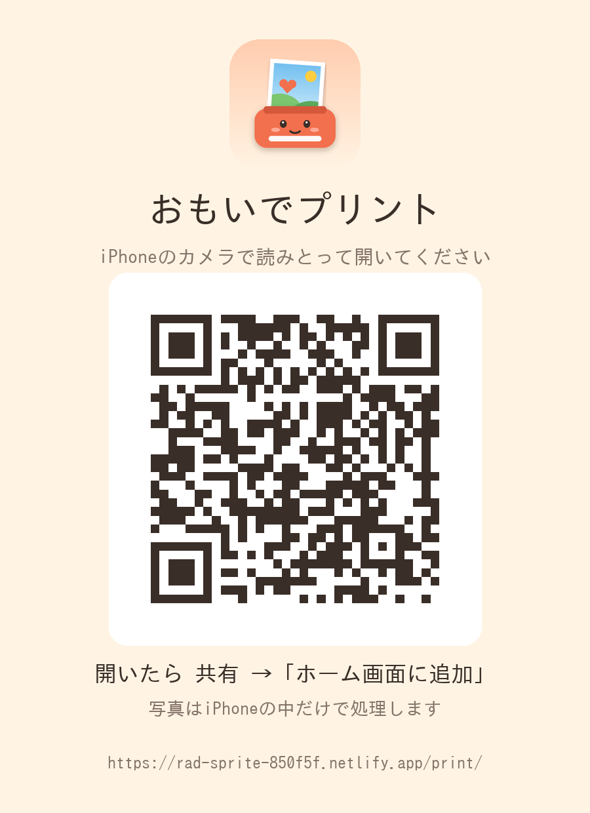

# おもいでプリント（iPhone の写真をまとめてプリント）

iPhone の写真を、用紙に合わせて切り取り、日付と年齢を入れて、**まとめて iPhone 標準のプリント（AirPrint）に渡す** Web アプリです。
EPSON のアプリを通さないので、「一度に 20 枚まで」「印刷中はアプリを開いたまま」という EPSON アプリ側の制約から外れます。

- 写真は **iPhone の中（ブラウザの中）だけ**で処理します。インターネットには送りません
- 方向性を決めた理由・調べた事実と出典・今後の予定は
  [設計書](../../docs/superpowers/specs/2026-10-17-omoide-print-design.md) にまとめています

---

## iPhone に入れる（アイコンでアプリのように開く）

本番のアドレス: **https://rad-sprite-850f5f.netlify.app/print/**
（Netlify のサイト名 `rad-sprite-850f5f` から決まるアドレス。プルリクエストをマージしたあと、このアドレスで開けるかの確認が必要）

1. 下のカードの QR コードを iPhone のカメラで読む（またはアドレスを Safari で開く）
2. 画面の上に出る案内のとおり、共有ボタン（見当たらないときは「…」→「共有」）→「ホーム画面に追加」→「追加」
3. ホーム画面のアイコン（にこにこプリンター）から開く



- **ほかの家族のスマホに入れる**: このカード画像（`img/install-card.png`）を LINE などで送り、カメラで読みとってもらう
- **すぐ開ける**: 一度開くと画面のファイルを iPhone に保存するので、次からはすぐ立ち上がり、電波がなくても開けます
- **更新**: GitHub と Netlify が連携済みなので、変更が Netlify の公開ブランチに入ると自動で公開されます。
  ホーム画面のアプリは、次に開いたときに新しい版へ入れかわります（どのブランチが公開に使われているかは Netlify の設定画面で確認が必要。`netlify.toml` は変更していません）

## つかいかた

1. 「📷 写真をえらぶ」→「写真ライブラリ」で何枚でも選ぶ（あとから「＋ 追加」もできる）
2. 上の 4 つをえらぶ
   - **用紙**: L判 / KG / はがき / 2L判 / A4
   - **ならべ方**: 1枚に1つ / 2面 / 4面（連絡帳に貼る小さい写真や、用紙の節約に）
   - **フチ**: なし・切りとる / あり・全部入れる
   - **文字**: なし / 日付 / 日付＋年齢（⚙設定で子どもの名前と誕生日を入れる・4人まで）
3. 「じゅんびする」→「🖨 プリントする」
4. 出てきた画面で「プリント」→ プリンターと用紙サイズをえらんでプリント

写真をタップすると、切り取る位置（指でずらす・2本指で拡大）、回転、撮影日、写っている子をかえられます。

### 子どもの写真が多い家のための機能

| 機能 | 内容 |
|---|---|
| 日付と年齢 | 撮影日（写真の記録）から「'26 5 5」「つばき 3さい1かげつ」を写真の右下に入れる。生まれて1か月までは「うまれて12にち」。**撮影日がわからない写真には入れない**（ウソの日付は入れない。タップして手で入れることはできる） |
| 似ている写真 | 連写などの似た写真に同じ色の「似ている」印。いちばんくっきりした1枚に★。「★だけ残す」1回で他をはずす |
| 印刷済み | 送った写真を iPhone の中に記録。次に選んだとき「印刷済み」と出て、「はずす」1回で除ける |
| 枚数 | 写真ごとに「＋」で 2 枚、3 枚…（おじいちゃん・おばあちゃん用など） |
| 並び順 | 撮影日の古い順に自動で並べる |

## EW-M873T で使うとき

お使いのプリンター（EPSON EW-M873T）は、EPSON 公式の AirPrint 対応機種の一覧に載っています（[エプソン: AirPrint](https://www.epson.jp/connect/ext/airprint/)）。

### 実機で確かめたこと（2026-10-17）

- L判の写真用紙を **背面トレイ**（本体の後ろの上に、紙を立てて入れるトレイ）に入れ、このアプリから送ると、背面トレイから印刷できた
- 1回目は上トレイが選ばれ、「用紙がありません」が続いた。2回目は何も設定を変えずに背面トレイから印刷できた。**違いの原因はわかっていない**
- 上トレイは紙を巻き込むことがあるので使っていない

### 手順

1. L判の写真用紙を背面トレイに入れる。プリンターの画面に用紙設定が出たら、**用紙サイズ「L判」と用紙の種類**を登録する
   （[ユーザーズガイド: 用紙サイズと種類の登録](https://download4.epson.biz/sec_pubs/ew-m873t_series/useg/ja/GUID-0BD7680A-C5B2-428D-BFCB-2B09DB56A919.htm)）
2. アプリから送る。iPhone のプリント画面では用紙サイズを「L判」にする
3. 写真用紙を入れていない上トレイが選ばれて「用紙がありません」が続くときは、上トレイに登録されている用紙サイズを L判以外（ハガキなど）に変えてみる。
   プリンターは、印刷の用紙サイズと各トレイに登録した用紙サイズを照らし合わせて給紙口を選ぶため（EPSON の他機種の説明書と利用者の書き込みによる。EW-M873T で直るかは確認が必要）

### 知っておくこと

- iPhone のプリント画面には給紙口を選ぶ項目がありません。給紙口はプリンターが選びます
- 背面トレイに入る EPSON 純正の L判写真用紙は 20 枚までです（[ユーザーズガイド: エプソン製専用紙](https://download4.epson.biz/sec_pubs/ew-m873t_series/useg/ja/GUID-35FF1D3E-4F73-463F-9C77-58B809460657.htm)）。
  21枚以上まとめて送ると途中で用紙の補充が必要になる見込みです（補充したあと続きが出るかは確認が必要）
- 手差し給紙（1枚ずつ差し込む口）は、同じ一覧で L判の写真用紙の対象外です

## はじめて使うときに確かめること（実機での確認が必要）

この環境では iPhone 実機で試せていません。次の点は **2〜3 枚で試して確かめてください**。

1. 「プリントする」で出る画面に「プリント」があるか
2. プリンターと用紙サイズ（L判など）がえらべるか
3. 「プリント」を押したあと、このアプリを閉じても印刷が続くか
4. 横向きの写真が正しい向き・大きさで出るか
5. 日付が正しいか（写真の記録が iPhone の写真選択画面を通しても残っているか）

## うまくいかないとき

| こまったこと | やること |
|---|---|
| 「プリント」が出ない | 同じ画面の「画像を保存」→ 写真アプリから共有 → プリント。または下の「ブラウザで印刷」 |
| 一度に送れる枚数に上限があった | ⚙設定「まとめて送る枚数」を 50 / 20 / 10 枚に |
| 横向きの写真が小さく出る | ⚙設定「よこ写真を たてに回してから送る」をオン（日付も写真といっしょに回ります） |
| プリンターが AirPrint に対応していない | 「プリントする」で出る画面に EPSON のアプリがあればそこへ（出るかは確認が必要）。なければ「画像を保存」→ EPSON アプリで選ぶ。⚙設定を「20 枚ずつ」にすると EPSON アプリの上限に合わせて分けて送れる |
| 送ってないのに「印刷済み」になった | 直後に出る「もとにもどす」。⚙設定の「記録を消す」でぜんぶ消せる |

---

## しくみ（開発メモ）

```
suuji-nazori/print/
├─ index.html            画面とデザイン（印刷用の @page もここ）
├─ core.js               計算だけ（用紙・マス割り・切り取り・回転・年齢・EXIF・似ている判定）。Node でもテストできる
├─ app.js                画面の操作・読み込み・印刷用画像づくり・共有
├─ manifest.webmanifest  ホーム画面に追加したときの名前とアイコン
├─ sw.js                 すぐ開けるように画面のファイルを端末に保存する（/print/ の中だけ。写真は扱わない）
└─ img/                  アイコン（tools/make_omoide_icons.py）と案内カード（tools/make_omoide_qr.py）で作り直せる
```

- 印刷用の画像は 300dpi の JPEG（L判なら 1051×1500px）。画面のプレビュー・調整画面・本番の書き出しは、どれも `core.js` の同じ関数（`placePhoto` / `drawPhoto` / `drawStamp`）で描く
- iPhone の共有シートはボタンを押した直後でないと開けないため、「じゅんびする」（重い処理）と「プリントする」（共有）を分けている
- 似ている判定: 形（9×8 の dHash）と色合い（4×4 の平均色）の両方が近いもの。しきい値は `core.js` の `SIMILAR`
- 設定と印刷済みの記録は `localStorage`（`omoide.settings` / `omoide.printed` / `omoide.installHidden`）だけに保存
- `sw.js` は保存分をすぐ返し、裏で最新版を取りに行く（次に開いたときに反映）。画面のファイルを足したり消したりしたときだけ、`sw.js` の `ASSETS` と `CACHE` の番号を変える
- すうじアプリの `sw.js` は、更新のたびに自分以外の保存分を消す作りになっている。そのときは `/print/` の保存分も消えるが、次に開いたときに取り直すので動作は変わらない

### テスト

```bash
bash tests/omoide-print/run.sh
```

1 回で次を全部流します（Chromium・iPhone 13 の画面サイズ）。

- 計算部分のテスト 19 件（用紙サイズ、切り取り、年齢、EXIF、似ている判定など）
- 画面テスト 22 件（ホーム画面に追加の案内、アイコンと manifest、読み込み、似ている写真、日付と年齢、L判の画像の大きさと中身、印刷済みの記録、ブラウザ印刷の PDF のページの大きさ、調整画面、4面、分けて送る、電波がなくても開けること、すうじアプリと同じ端末で動くこと、外部への通信がないこと、エラーがないこと）

iPhone の共有シート・プリント画面・HEIC 写真の扱いは Chromium では再現できないため、上の「はじめて使うときに確かめること」で確認します。
